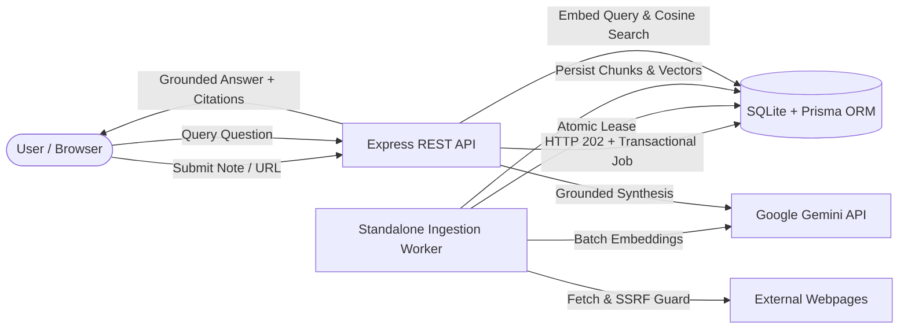
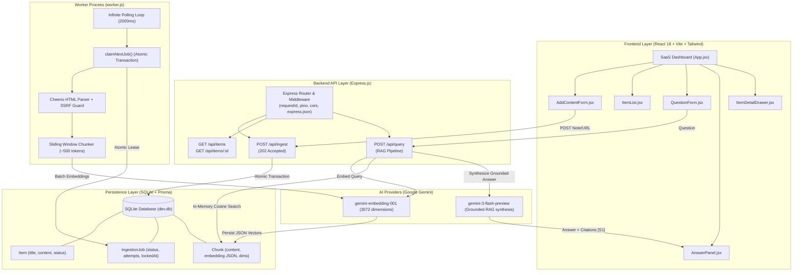
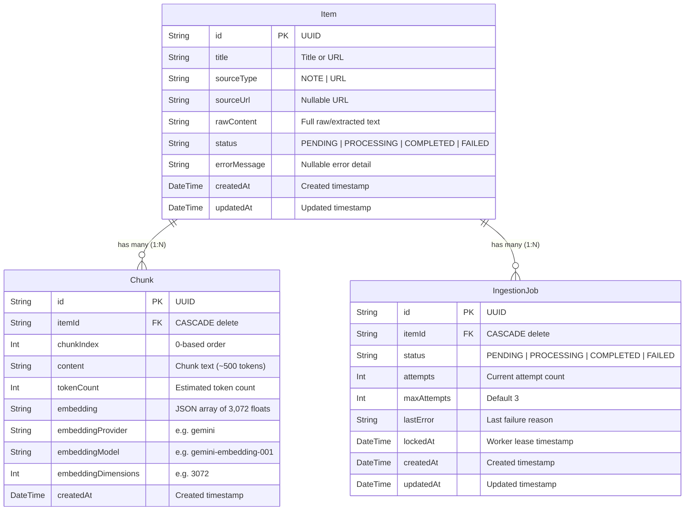

# Turium AI Knowledge Inbox — Complete Project Knowledge Base

> A single, self-contained technical guide to the **Turium AI Knowledge Inbox**: what it does, real-world use cases, complete folder structure, how every layer works end-to-end, API contracts, database design, security controls, provider switching, setup, and architectural tradeoffs.

---

## Table of Contents

1. [Executive Overview & Problem Statement](#1-executive-overview--problem-statement)
2. [Real-World Use Cases](#2-real-world-use-cases)
3. [System Architecture](#3-system-architecture)
4. [Complete Folder & File Structure](#4-complete-folder--file-structure)
5. [How the Application Works (End-to-End Workflows)](#5-how-the-application-works-end-to-end-workflows)
6. [Technology Stack & Key Engineering Decisions](#6-technology-stack--key-engineering-decisions)
7. [Database Schema & Persistence Design](#7-database-schema--persistence-design)
8. [REST API Reference Summary](#8-rest-api-reference-summary)
9. [AI Provider Abstraction & Switching (Gemini / OpenAI)](#9-ai-provider-abstraction--switching-gemini--openai)
10. [Security & Reliability Controls](#10-security--reliability-controls)
11. [Setup, Running & Testing Guide](#11-setup-running--testing-guide)
12. [Verified Metrics, Tradeoffs & Scaling Roadmap](#12-verified-metrics-tradeoffs--scaling-roadmap)
13. [Architectural Invariants](#13-architectural-invariants)

---

## 1. Executive Overview & Problem Statement

The **Turium AI Knowledge Inbox** is a full-stack, single-user AI knowledge management web application built with native JavaScript ES modules, Express.js, Prisma + SQLite, Google Gemini AI, and React + Vite + Tailwind CSS. It lets users save **plain-text notes** and **web URLs**, processes them asynchronously into vector embeddings in a separate background worker, and answers natural-language questions grounded strictly in saved content with verified, clickable citations.

### The Problem
- **Traditional keyword search** (`SQL LIKE` / lexical matching) fails when users search using synonyms, abstract concepts, or questions spanning multiple saved notes.
- **Public AI chatbots** have zero visibility into private notes or newly saved URLs and tend to hallucinate plausible-sounding answers when context is missing.
- **Naive synchronous ingestion** (fetching web pages and calling embedding APIs inside an HTTP route) causes slow user experiences, blocked Node.js connections, HTTP timeouts, and **SSRF (Server-Side Request Forgery)** vulnerabilities.

### The Solution
1. **Asynchronous Decoupling**: `POST /api/ingest` validates payloads via Zod, writes an `Item` and `IngestionJob` in a single atomic SQLite transaction, and immediately returns `HTTP 202 Accepted` (~10–15ms).
2. **Independent Background Worker**: A separate Node.js process (`worker.js`) polls SQLite, claims jobs using atomic leases, fetches web pages through an SSRF defense guard, chunks text deterministically, generates 3,072-dimensional Gemini embeddings, and persists chunks atomically.
3. **Grounded RAG with Verified Citations**: `POST /api/query` embeds the user's question, performs cosine similarity search across indexed chunks, synthesizes an answer via Gemini Flash using strict grounding instructions, verifies every `[S1]`/`[S2]` tag against retrieved database chunks, prunes hallucinated tags, and returns clickable source cards.

---

## 2. Real-World Use Cases

| Use Case | How Turium AI Knowledge Inbox Solves It |
| :--- | :--- |
| **Personal Research & Reading Hub** | Save technical articles, documentation URLs, and reading notes in one inbox; ask conceptual questions across all saved material instead of manually reopening dozens of browser tabs. |
| **Engineering Knowledge Base** | Store architecture notes, postmortems, runbooks, and external specs. Query exact setup details and trace every claim back to the original passage via `[S1]` citations. |
| **Study & Interview Preparation** | Ingest lecture notes and reference web pages, then query topics in natural language to synthesize concise, source-backed summaries without outside hallucination. |
| **Meeting & Project Notes Assistant** | Dump raw meeting notes (even without titles—the system auto-derives titles from the first line) and ask questions like *"What database decisions were made last week?"* |
| **Safe Web Archiving for AI** | Extract clean readable article text from public URLs (stripping scripts, navbars, ads, and footers) while blocking unsafe internal/private network targets via SSRF protection. |
| **Pluggable AI Prototyping** | Swap between Google Gemini, OpenAI, or offline Mock providers via environment variables without changing business logic, routes, or the frontend. |

---

## 3. System Architecture

### 3.1 High-Level Data Flow



### 3.2 Full Component Architecture



### 3.3 Strict Layered Separation

```text
Routes ──► Middleware (Request ID, Zod) ──► Controllers ──► Services ──► Repositories ──► Prisma ──► SQLite
                                                               │
                                                               ▼
                                                    AI Provider Adapters
                                                   (Gemini / OpenAI / Mock)
```

---

## 4. Complete Folder & File Structure

```text
TuriumAssign/
├── .gitignore                                 # Excludes .env, *.db, node_modules, dist, logs
├── README.md                                  # Quickstart, API examples & overview
├── COMPLETE_PROJECT_KNOWLEDGE_BASE.md         # This consolidated technical reference
│
├── backend/                                   # Node.js + Express REST API & Background Worker (ESM)
│   ├── .env.example                           # Environment variable template (safe placeholders)
│   ├── package.json                           # Backend scripts (dev, start, worker, test) & deps
│   ├── vitest.config.js                       # Sequential singleFork Vitest config for SQLite safety
│   │
│   ├── prisma/
│   │   ├── schema.prisma                      # Relational models: Item, Chunk, IngestionJob
│   │   └── migrations/                        # Timestamped SQLite migration DDL
│   │
│   ├── src/
│   │   ├── server.js                          # HTTP server entry point (port 5000, graceful shutdown)
│   │   ├── app.js                             # Express app factory, middleware stack & route mounting
│   │   ├── worker.js                          # Standalone background worker process loop
│   │   │
│   │   ├── config/
│   │   │   ├── env.js                         # Zod startup validation of all environment variables
│   │   │   ├── logger.js                      # Pino structured JSON logger (pino-pretty in dev)
│   │   │   └── prisma.js                      # Shared PrismaClient singleton
│   │   │
│   │   ├── routes/                            # Express route definitions
│   │   │   ├── health.routes.js               # GET /api/health
│   │   │   ├── ingest.routes.js               # POST /api/ingest
│   │   │   ├── items.routes.js                # GET /api/items, GET /api/items/:id
│   │   │   └── query.routes.js                # POST /api/query
│   │   │
│   │   ├── middleware/
│   │   │   ├── request-id.middleware.js       # Attaches/propagates x-request-id UUID
│   │   │   ├── validate.middleware.js         # Higher-order Zod request body validator
│   │   │   └── error.middleware.js            # AppError class & centralized JSON error handler
│   │   │
│   │   ├── schemas/
│   │   │   ├── ingest.schema.js               # Discriminated union schema for NOTE & URL ingestion
│   │   │   └── query.schema.js                # Validation schema for question & topK (1–20)
│   │   │
│   │   ├── controllers/                       # Thin HTTP handlers (no DB or AI calls)
│   │   │   ├── ingest.controller.js           # Handles POST /api/ingest -> HTTP 202
│   │   │   ├── items.controller.js            # Handles item list & item detail retrieval
│   │   │   └── query.controller.js            # Handles POST /api/query -> HTTP 200
│   │   │
│   │   ├── services/                          # Core business logic & pipelines
│   │   │   ├── ingestion.service.js           # Note/URL queuing, fallback titles, item queries
│   │   │   ├── job.service.js                 # Worker job pipeline, retries & atomic completion
│   │   │   ├── url-extraction.service.js      # Safe HTTP fetching, redirect checks & Cheerio parsing
│   │   │   ├── chunking.service.js            # Deterministic ~500-token chunking w/ 50-token overlap
│   │   │   ├── embedding.service.js           # Coordinates chunk & query embeddings via provider
│   │   │   ├── retrieval.service.js           # In-memory cosine search, topK & threshold filtering
│   │   │   └── rag.service.js                 # Prompt construction, LLM call & citation verification
│   │   │
│   │   ├── repositories/                      # Data Access Objects encapsulating Prisma
│   │   │   ├── item.repository.js             # Transactional item + job creation, item queries
│   │   │   ├── job.repository.js              # Atomic job claiming, stale-lock recovery, status updates
│   │   │   └── chunk.repository.js            # Batch chunk persistence & cleanup
│   │   │
│   │   ├── providers/                         # Pluggable AI vendor adapters & registries
│   │   │   ├── embeddings/
│   │   │   │   ├── index.js                   # Embedding registry + offline MockEmbeddingProvider
│   │   │   │   └── gemini.embeddings.js       # Google Gemini gemini-embedding-001 (3,072 dims)
│   │   │   └── llm/
│   │   │       ├── index.js                   # LLM registry + offline MockLLMProvider
│   │   │       └── gemini.llm.js              # Google Gemini Flash adapter w/ retry & model fallback
│   │   │
│   │   └── utils/
│   │       ├── safe-url.js                    # SSRF defense: DNS lookup & private/metadata IP blocking
│   │       └── cosine-similarity.js           # Pure vector cosine similarity math & validation
│   │
│   └── tests/                                 # 15 Vitest + Supertest suites (77 automated tests)
│       ├── safe-url.test.js                   # SSRF IP range & protocol checks
│       ├── url-extraction.test.js             # Cheerio HTML stripping & text normalization
│       ├── chunking.test.js                   # Sliding-window chunking & boundary tests
│       ├── cosine-similarity.test.js          # Vector similarity math edge cases
│       ├── embeddings.test.js                 # Gemini embedding batching & retry tests
│       ├── llm-provider.test.js               # Gemini LLM retry & fallback tests
│       ├── providers.test.js                  # Provider factory & registry tests
│       ├── chunk-persistence.test.js          # SQLite chunk storage & cascade delete tests
│       ├── ingest.test.js                     # POST /api/ingest & GET /api/items API tests
│       ├── worker.test.js                     # Job leasing, retries, stale locks & idempotency
│       ├── worker-embeddings.test.js          # Full worker-to-vector pipeline tests
│       ├── retrieval.test.js                  # Cosine ranking, thresholds & dimension checks
│       ├── rag.test.js                        # Grounding prompt & citation pruning tests
│       ├── query-api.test.js                  # POST /api/query integration tests
│       └── health.test.js                     # GET /api/health endpoint tests
│
└── frontend/                                  # React 18 + Vite 6 + Tailwind CSS 3 SPA
    ├── index.html                             # HTML root mount
    ├── package.json                           # Frontend dependencies (react, lucide-react, tailwind)
    ├── vite.config.js                         # Vite bundler & /api -> localhost:5000 dev proxy
    ├── tailwind.config.js                     # Tailwind CSS configuration
    ├── postcss.config.js                      # PostCSS plugin setup
    └── src/
        ├── main.jsx                           # React DOM entry point
        ├── index.css                          # Tailwind directives
        ├── App.jsx                            # Responsive 2-column / mobile-tab SaaS dashboard
        ├── services/
        │   ├── apiClient.js                   # Fetch wrapper with standardized error normalization
        │   ├── items.api.js                   # API helpers for items & ingestion
        │   └── query.api.js                   # API helper for RAG queries
        ├── hooks/
        │   ├── useItems.js                    # Item list state, drawer state & smart 2.5s polling
        │   ├── useIngestion.js                # Note/URL form validation & submission state
        │   └── useQuery.js                    # Question state, answers & citation scroll highlight
        └── components/
            ├── Header.jsx                     # Top bar with live sync heartbeat & active job count
            ├── AddContentForm.jsx             # Tabbed Note/URL ingestion form w/ token estimator
            ├── ItemList.jsx                   # Searchable, filterable knowledge library
            ├── ItemCard.jsx                   # Individual item summary card
            ├── ProcessingBadge.jsx            # Status pills (Pending, Processing, Completed, Failed)
            ├── ItemDetailDrawer.jsx           # Slide-over full content & metadata viewer
            ├── QuestionForm.jsx               # Question textarea, top-K slider & sample prompts
            ├── AnswerPanel.jsx                # Grounded answer with clickable [S1]/[S2] badges
            └── SourceCitation.jsx             # Interactive source cards with snippets & links
```

---

## 5. How the Application Works (End-to-End Workflows)

### 5.1 Content Ingestion (Notes & URLs)
1. **Submission (`AddContentForm.jsx` → `POST /api/ingest`)**:
   - **Notes**: Require non-empty `content` (max 2 MB). If `title` is omitted, `ingestionService.ingestNote` uses the first line (up to 60 chars) or `'Untitled Note'`.
   - **URLs**: Must be valid `http://` or `https://` URLs.
2. **Atomic Enqueue (`item.repository.js`)**: A single `prisma.$transaction()` creates both the `Item` (`status: 'PENDING'`) and an `IngestionJob` (`status: 'PENDING'`, `attempts: 0`, `maxAttempts: 3`).
3. **Non-Blocking Response**: The API responds with `HTTP 202 Accepted` in ~10–15ms.
4. **Live UI Sync (`useItems.js`)**: When any item has status `PENDING` or `PROCESSING`, the frontend automatically polls `GET /api/items` every **2.5 seconds**, and immediately stops polling once all items settle into `COMPLETED` or `FAILED`.

### 5.2 Asynchronous Background Worker (`worker.js` + `job.service.js`)
1. **Polling & Atomic Lease**: The standalone worker process polls every `2000ms` (or loops immediately if work was found). `jobRepository.claimNextJob()` runs a Prisma transaction to find the oldest `PENDING` job—or a stale `PROCESSING` job whose `lockedAt` is older than 5 minutes (`JOB_STALE_LOCK_MS = 300000`)—sets `status = 'PROCESSING'`, sets `lockedAt = now`, and increments `attempts`.
2. **URL Extraction & SSRF Defense (`url-extraction.service.js` + `safe-url.js`)**:
   - For `URL` items, `validateAndResolveUrl()` resolves DNS first and blocks loopback (`127.0.0.0/8`, `::1`), RFC 1918 private networks (`10.0.0.0/8`, `172.16.0.0/12`, `192.168.0.0/16`), link-local / cloud metadata (`169.254.169.254`), dotless hosts, and embedded credentials.
   - Uses `redirect: 'manual'` to re-validate every redirect target (max 5 hops), enforces a 15s timeout and 2 MB cap, and uses **Cheerio** to strip `<script>`, `<style>`, `<nav>`, `<footer>`, `<aside>`, and extract clean title + body text.
3. **Deterministic Chunking (`chunking.service.js`)**:
   - Splits content into **~500-token chunks** (~2,000 chars at 4 chars/token) with **~50-token sliding overlap** (~200 chars) so context is never severed across boundaries.
   - Preserves paragraph breaks (`\n\n`) first, falling back to lines, sentences, and words.
4. **Batch Embedding Generation (`embedding.service.js` + `gemini.embeddings.js`)**:
   - Sends chunks in batches of up to 25 to Google's `gemini-embedding-001` (`batchEmbedContents`), producing **3,072-dimensional** floating-point vectors, validating length and finite numbers.
5. **Idempotent Atomic Commit**: Inside `prisma.$transaction()`, the worker deletes any previous chunks for that `itemId` (preventing duplicates on retries), inserts the new chunks with JSON-serialized vectors, and marks both `Item` and `IngestionJob` as `COMPLETED`.
6. **Bounded Retries**: If an error occurs and `attempts < 3`, the job returns to `PENDING`; after 3 failed attempts, both job and item are marked `FAILED` with the error message.

### 5.3 Semantic Retrieval & Grounded RAG (`rag.service.js` + `retrieval.service.js`)
1. **Query Embedding**: `POST /api/query` validates the question (1–1000 chars) and optional `topK` (1–20), then embeds the question with `gemini-embedding-001` (3,072 dims).
2. **Cosine Similarity Search (`cosine-similarity.js`)**: Loads chunks belonging only to `COMPLETED` items, skips any vector whose dimensions do not match the query vector, and calculates:
   $$\text{similarity}(A, B) = \frac{A \cdot B}{\|A\|_2 \|B\|_2}$$
   Chunks meeting `minSimilarity` are sorted descending and sliced to `topK` (default 5).
3. **Prompt Encapsulation**: Top chunks are labeled `[S1]`, `[S2]`, ... and wrapped inside `--- BEGIN CONTEXT ---` / `--- END CONTEXT ---` with strict system instructions commanding the LLM to treat context as untrusted quoted material, never use outside knowledge, and state when saved content does not provide the answer.
4. **Grounded Synthesis (`gemini.llm.js`)**: Sends the prompt to `gemini-3-flash-preview` (temperature `0.2`, 20s timeout, exponential backoff on 429/503, automatic fallback to `gemini-2.5-flash`).
5. **Citation Verification & Pruning (`_verifyCitations`)**: Scans the answer with `/\[(S\d+)\]/g`. Any fabricated label not in the retrieved `labelMap` is stripped from the answer text. Valid labels map to database titles, URLs, and 200-character snippets rendered as clickable cards in `AnswerPanel.jsx`.

---

## 6. Technology Stack & Key Engineering Decisions

| Layer | Technology | Rationale |
| :--- | :--- | :--- |
| **Runtime** | Node.js v20+ (ES Modules) | Native `import`/`export` across backend and frontend; modern `fetch` and `AbortSignal.timeout`. |
| **Backend API** | Express 4.21 + Zod + Pino | Minimal HTTP framework with strict runtime schema validation and structured request-ID logging. |
| **Database & ORM** | SQLite 3 + Prisma 6 | Zero-configuration single-file database (`dev.db`) with ACID transactions and cascade rules; no Docker needed locally. |
| **Job Queue** | SQLite `IngestionJob` Table | Transactional consistency between item creation and job enqueueing without requiring Redis/RabbitMQ. |
| **HTML Extraction** | Cheerio 1.0 | Fast (<10ms), lightweight (<10 MB RAM) server-side DOM parsing without Chromium/Puppeteer overhead. |
| **Vector Storage** | JSON Vectors in SQLite + In-Memory Cosine | Eliminates external vector DB dependencies (Pinecone/Qdrant) for single-user workloads (<10k chunks). |
| **AI Embeddings** | Google Gemini `gemini-embedding-001` | Produces 3,072-dimensional semantic vectors with native batch API support. |
| **AI LLM** | Google Gemini `gemini-3-flash-preview` | Low latency (~1.3s), strong grounding adherence, automatic fallback to `gemini-2.5-flash`. |
| **Frontend** | React 18 + Vite 6 + Tailwind CSS 3 | Fast HMR, clean component design, minimal state using native React hooks, Lucide icons. |
| **Testing** | Vitest 3 + Supertest 7 | Fast ESM-native unit & HTTP integration tests running offline against deterministic mock providers. |

---

## 7. Database Schema & Persistence Design

Defined in `backend/prisma/schema.prisma`:



- **Important Storage Distinction**: SQLite is used as a relational database storing vectors as serialized JSON text—**not** a dedicated vector database or `sqlite-vec` extension. Similarity ranking is computed in-memory in Node.js.
- **Cascading Integrity**: Deleting an `Item` automatically cascade-deletes all associated `Chunk` and `IngestionJob` records.

---

## 8. REST API Reference Summary

All responses follow a standardized envelope: `{ success: boolean, data: object | null, error: { code, message } | null }` with an `x-request-id` header.

| Method | Endpoint | Purpose | Success Status |
| :--- | :--- | :--- | :---: |
| `GET` | `/api/health` | Server health, uptime & timestamp check | `200 OK` |
| `POST` | `/api/ingest` | Queue a `NOTE` (`{ sourceType, title?, content }`) or `URL` (`{ sourceType, url }`) | `202 Accepted` |
| `GET` | `/api/items` | List saved items with metadata, status & `chunkCount` | `200 OK` |
| `GET` | `/api/items/:id` | Retrieve single item with full `rawContent` & metadata | `200 OK` |
| `POST` | `/api/query` | Ask a question (`{ question, topK? }`) and receive grounded answer + verified citations | `200 OK` |

---

## 9. AI Provider Abstraction & Switching (Gemini / OpenAI)

Business services (`rag.service.js`, `embedding.service.js`, `job.service.js`) never import Gemini code directly. They call `getLLMProvider()` and `getEmbeddingProvider()` from the registries in `backend/src/providers/`.

### Standard Adapter Interfaces
- **Embedding Provider**: `embedDocuments(texts: string[]) => Promise<number[][]>` and `embedQuery(text: string) => Promise<number[]>`
- **LLM Provider**: `generateAnswer({ systemPrompt, userPrompt, temperature }) => Promise<{ text: string, usage?: object }>`

### Switching from Gemini to OpenAI
1. Add `backend/src/providers/llm/openai.llm.js` and/or `backend/src/providers/embeddings/openai.embeddings.js` implementing the exact interfaces above.
2. Register them in `backend/src/providers/llm/index.js` and `backend/src/providers/embeddings/index.js`.
3. Update `backend/.env`:
   ```env
   LLM_PROVIDER=openai
   LLM_MODEL=gpt-4o-mini
   EMBEDDING_PROVIDER=openai
   EMBEDDING_MODEL=text-embedding-3-small
   OPENAI_API_KEY=sk-...
   ```
- **Hybrid Mode (Gemini Embeddings + OpenAI LLM)**: Works immediately with **zero re-embedding** required.
- **Changing Embedding Provider**: Requires re-embedding existing items because vector spaces and dimensions differ (Gemini `gemini-embedding-001` = 3,072 dims vs. OpenAI `text-embedding-3-small` = 1,536 dims).

---

## 10. Security & Reliability Controls

- **SSRF Protection**: Pre-fetch DNS resolution + private/loopback/cloud-metadata IP filtering + manual redirect re-validation (max 5 hops) + 2 MB size cap + 15s timeout.
- **Prompt Injection Mitigation**: Context isolated inside `--- BEGIN CONTEXT ---` / `--- END CONTEXT ---` with untrusted source directives and low temperature (`0.2`).
- **Citation Hallucination Pruning**: Regex verification strips ungrounded `[Sn]` markers before client delivery.
- **Resilience**: Exponential retry backoff on HTTP 429/503, 20s request timeouts, automatic Gemini fallback model (`gemini-2.5-flash`), atomic worker leases, and 5-minute stale-lock recovery.
- **Credential Hygiene**: `.env` and `*.db` excluded via `.gitignore`; offline tests automatically default to mock providers when `NODE_ENV=test`.

---

## 11. Setup, Running & Testing Guide

### Prerequisites
- Node.js `v20+` (tested on `v24.15.0`) and npm `v10+`
- Google AI Studio API Key (`GEMINI_API_KEY`)

### Setup & Launch (3 Terminals)

```bash
# 1. Backend setup
cd backend
npm install
cp .env.example .env
# Edit backend/.env and add your GEMINI_API_KEY
npx prisma generate
npx prisma migrate dev --name init

# 2. Frontend setup
cd ../frontend
npm install
```

Run each process in its own terminal:

```bash
# Terminal 1 — Backend API Server (http://localhost:5000)
cd backend && npm run dev

# Terminal 2 — Background Ingestion Worker (use worker:start to avoid watch restarts)
cd backend && npm run worker:start

# Terminal 3 — Frontend Dashboard (http://localhost:5173)
cd frontend && npm run dev
```

### Verification Commands

```bash
# Run offline backend unit & integration tests (15 suites, 77 tests)
cd backend && npm test

# Build frontend production bundle
cd frontend && npm run build
```

---

## 12. Verified Metrics, Tradeoffs & Scaling Roadmap

### Observed Verification Results
- **Automated Tests**: 15/15 test files, **77/77 tests passing** (`npm test` in ~5–6s).
- **Frontend Production Build**: Clean Vite build in **4.18s** with 0 errors.
- **Live Gemini End-to-End Test**: Verified 3,072-dim embedding persistence (~482ms), grounded answer citing `[S1]` (similarity `0.702`), and non-fabrication refusal on unrelated questions (`sources: []`).

### Key Tradeoffs & Production Scaling Path

| Current Design | Why It Fits This Scope | Scale Limit | Production Upgrade |
| :--- | :--- | :--- | :--- |
| **SQLite + JSON Vectors** | Single-file portability, zero infra setup | $\mathcal{O}(N \times D)$ scan; memory pressure at 100k+ chunks | **PostgreSQL + `pgvector`** with HNSW index ($\mathcal{O}(\log N)$) |
| **SQLite Job Polling** | No Redis/broker dependency | File-level write locks (`SQLITE_BUSY`) under multi-worker load | **Redis BullMQ** or **Temporal** event-driven queue |
| **Cheerio HTML Parser** | Fast (<10ms), tiny memory footprint | Cannot render client-side JavaScript SPAs | Hybrid worker with **Playwright** fallback pool |
| **Pre-Fetch DNS SSRF Check** | Blocks private/metadata IPs & redirects | Theoretical DNS rebinding TOCTOU window | Custom Node `http.Agent` with resolved IP pinning |
| **Single-User (No Auth)** | Matches assessment scope | No multi-tenant isolation or API rate limiting | JWT/OAuth auth + `express-rate-limit` |

---

## 13. Architectural Invariants

1. **Controllers Never Call DB or AI Directly**: Controllers strictly handle HTTP transport and delegate to services; Prisma queries live in repositories.
2. **Ingestion Is Always Asynchronous**: `POST /api/ingest` must never chunk or embed synchronously; it enqueues a job and returns `202 Accepted`.
3. **Atomic Multi-Table Mutations**: Item + job creation and chunk replacement + completion must execute inside `prisma.$transaction()`.
4. **No Secret Exposure**: Never log, return, or commit `GEMINI_API_KEY` or `backend/.env`.
5. **Always Verify Citations**: Every LLM response passes through `_verifyCitations()` to validate and prune hallucinated `[Sn]` markers before reaching the UI.
